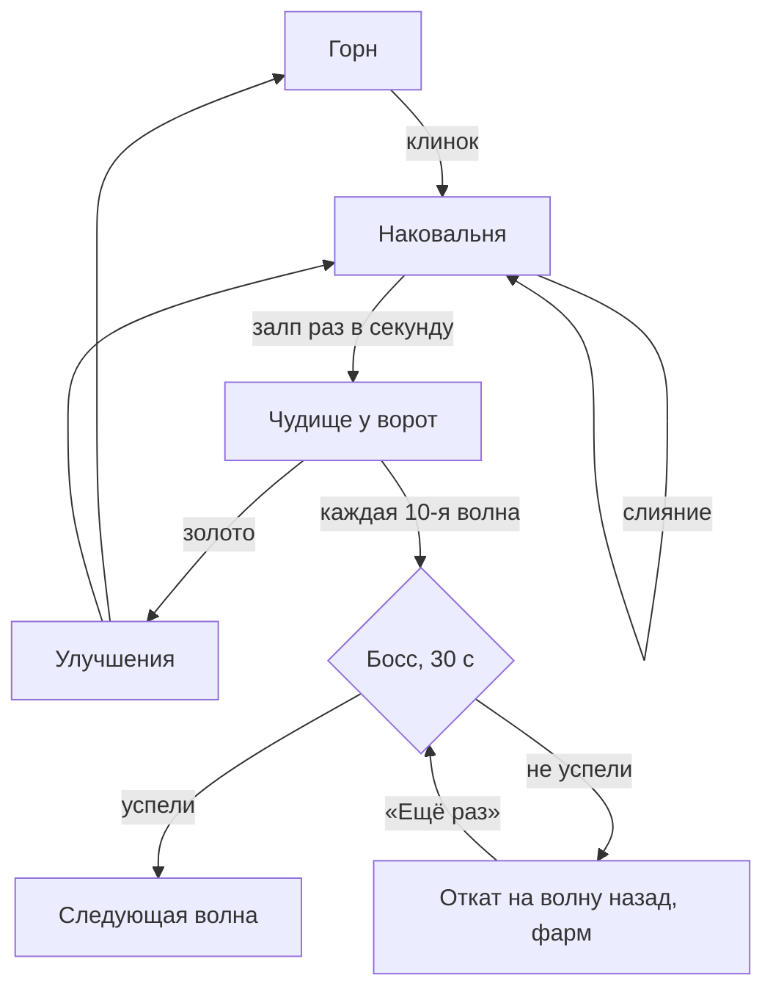

# Кузница слияний

Горн сам куёт клинки, два одинаковых сливаются в один уровнем выше, и все клинки на наковальне вместе рубят чудищ у ворот. Слияние бесконечно, и каждый новый уровень рисует модель-художник. Цифры ниже — по умолчанию, их можно поменять в «Настройках игры».

## С чего начать

1. Ждите клинки из горна или тапайте по горну: каждый тап сокращает цикл на 0,5 с, засчитывается до 8 тапов в секунду.
2. Перетаскивайте клинок на такой же — получится один уровнем выше. Двойной тап сливает клинок с ближайшим таким же.
3. Покупайте улучшения за золото. Первым делом «Остроту» и «Мехи».
4. Каждая десятая волна — босс с таймером в 30 с.

> **Полная наковальня:** горн продолжает ковать сам — новые клинки, которым не хватило места, сразу продаются. Нажатия ускоряют тот же цикл. Клинки на поле остаются на месте. Сумма и количество проданных клинков появляются у сундука.

Ручная ковка сохраняет обычный цикл и лимит тапов. «Удар молота» постепенно усиливает ручной удар, а «Лавка кузнеца» повышает выручку от продажи. На продажу влияют уровень горна, «Двойная поковка», «Удачная плавка», гроза и доля цены из «Лавки кузнеца». Слияния по-прежнему усиливают клинки для боя. Автоковка и продажа новых излишков продолжаются и офлайн в пределах обычного офлайн-расчёта. Клинки из сундуков ждут свободной клетки и не продаются автоматически.

## Рубежи улучшений

Улучшения разделены на «Ковку», «Бой» и «Доход». В карточке показаны фактическая прибавка следующей покупки, текущий результат и ближайший рубеж.

Тринадцать улучшений усиливают собственный вклад рубежами: Острота, Кошель, Тяжёлая рука, Двойная поковка, Закалка, Сила руны, Охотник за головами, Песочные часы, Боевой клич, Знамя, Караванщик, Удар молота и Лавка кузнеца.

- **Рубеж** приходит каждый раз, когда цена улучшения выросла в 10 000 раз, и не реже чем раз в 25 уровней. У Остроты и Кошеля, которые дешевеют медленно, — как прежде, каждые 25 уровней; у дорогих — чаще: у Тяжёлой руки каждые 17, у Закалки и Двойной поковки каждые 12, у Боевого клича каждые 10, у Знамени каждые 7. Так до рубежа доходят все улучшения, а не только самые дешёвые.
- Рубеж умножает эффект улучшения на **1,4**, каждый **четвёртый** — крупный — на **1,8**. У Двойной поковки, Песочных часов, Караванщика и Удара молота — на 1,1 и 1,2: они меняют сам ход игры.
- **Каждый крупный рубеж** открывает **особое свойство** — небольшой постоянный бонус в другом месте: шанс крита, урон или золото с боссов, время босса, офлайн-доход, скорость горна, выручку продаж, частоту событий, силу ручного удара или весь урон. У каждого улучшения два свойства, они идут по очереди **без конца**; свойство, открытое ещё раз, прибавляет столько же (×1,3, потом ×1,6, ×1,9…). В карточке у свойства — уровень, на котором оно придёт в следующий раз, и сколько оно даёт сейчас.
- Когда покупка проходит рубеж, игра сразу показывает, что он дал. Размеры рубежей и свойств — в настройках «Улучшения».

Это бонус самого улучшения, а не общий множитель всей игры. У улучшений с уменьшающейся отдачей она сохраняется. Реальные уровни, цены, число клеток, уровни клинков и пределы обычных шансов не пересчитываются. Достигнутые рубежи работают сразу после обновления; забирать награду отдельно не нужно.

Покупать можно по одному уровню, по десять или на всё золото (переключатель над списком). На кнопке «Улучшения» — сколько улучшений можно купить прямо сейчас.

## За пределом

У трёх улучшений есть естественный предел, но покупка на нём не кончается — дальше уровни делают новое:

- **Глаз мастера → Сокрушительный удар.** Шанс крита растёт до 40 %. Каждый следующий уровень добавляет 2 % к шансу, что крит ударит ещё раз (урон ещё раз умножается на силу крита). За 100 % второй повтор идёт всегда, а сверх — шанс третьего.
- **Шире наковальня → Резонанс.** После 35 клеток каждый уровень даёт +5 % урона клинку, рядом с которым по стороне стоит клинок того же уровня. Такие клетки подсвечены голубой рамкой. Подмастерье сливает пары, так что резонанс — повод держать одинаковые клинки рядом.
- **Негаснущий огонь → Перегрев.** См. «Жар горна».

Сокрушительный удар, резонанс и перегрев работают в бою на экране и не входят в офлайн-доход.

«Переплавка» стала частью «Лавки кузнеца»: Лавка открыта с начала забега и с каждым уровнем прибавляет 20 % к доле цены при продаже, пока продажа не станет полной.

Улучшения, которым расти уже некуда (Мехи, Рунная кладка, Подмастерье, Ночная смена), сворачиваются внизу вкладки в строку «Освоено» с уровнем.

## Жар горна

Тап по горну не только ускоряет ковку, но и раздувает жар. Пока горн горяч, клинки бьют чаще: при полном жаре залпы идут в полтора раза быстрее. Жар показывает полоска вдоль верхнего края кнопки горна; без тапов горн остывает за несколько секунд. Держать полный жар можно, не стуча на пределе: хватает пары тапов в секунду.

Два улучшения в разделе «Бой» прокачивают жар. «Жаркие угли» усиливают полный жар: залпы ещё чаще. «Негаснущий огонь» не даёт жару опуститься ниже своей доли: эта часть работает всегда, без тапов и офлайн, и входит в «фарм». После 40 % его уровни дают «Перегрев»: жар тапов сверх полного копит вспышку (около десяти тапов), и следующий залп бьёт сильнее — ×2 на первом таком уровне и +1 за каждый следующий. Готовая вспышка подсвечивает горн, копится до трёх. Урон в секунду с учётом жара показан наверху, рядом с фармом.

## Наковальня

| Жест | Что происходит |
|:--|:--|
| Клинок на такой же | Слияние: один клинок уровнем выше |
| Клинок на другой уровень | Меняются местами |
| Клинок на пустую клетку | Переезжает |
| Двойной тап | Слить с ближайшим таким же |
| Один тап | Выбрать клинок: «Герою», «Дракону» или «Продать». Действия открываются по прогрессу |
| Клинок в сундук | Продажа за 40 % цены, +20 % за уровень «Лавки кузнеца» — до полной |
| Сортировать | Сильные клинки первыми, одинаковые рядом, пустые клетки в конце; гнёзда рун сохраняют свою расстановку |

- **Размер:** в начале 12 клеток (4×3). «Шире наковальня» добавляет по клетке: сначала ряды до 4×5, потом пятый столбец и ещё два ряда — до 35.
- **Сила клинка:** урон и цена растут в 2,35 раза за уровень, поэтому слияние всегда выгоднее двух исходных клинков.
- **Руны:** с 25-й волны появляются гнёзда рун — огонь, лёд, жадность. Клинок в гнезде получает свойство руны. Ледяные руны замедляют таймер босса с убывающей отдачей, но без предела: первая — на 14%, каждая следующая и каждый уровень «Силы руны» дают меньше. Тап по камню руны в клетке открывает выбор: руна этого гнезда, «во все гнёзда» одним нажатием и «Авто» — лёд на боссе, жадность в остальных волнах. Камень можно перетащить на другую открытую клетку: гнездо переедет вместе с руной, а гнездо, которое там было, встанет на прежнее место. Каждое новое гнездо встаёт на **случайную открытую клетку** без гнезда — даже на маленькой наковальне все семь гнёзд на месте. Можно играть через маленькую наковальню, где руна достаётся почти каждому клинку, или расширять её ради места.

## Альбом металлов и истории клинков

«Горн мастера» → «Металлы» — все уровни клинков, открытые за всё время. Тап по открытому металлу показывает его карточку: картинку, тему, фразу о том, чем он необычен, и маленькую историю. У выбранного на наковальне клинка кнопка с книжкой открывает его карточку сразу. У первых сорока клинков истории написаны заранее; каждому новому клинку историю придумывает модель-художник вместе с рисунком.

## Миры и редкие враги

Дорога ведёт через десять миров по двадцать волн: Королевский тракт, Туманное болото, Жаркие пески, Конфетная страна, Морское дно, Детская, Кухня великанов, Лунная база, Неоновый город и Огненные недра. У каждого свой фон и пять своих врагов; боссы — те же враги под своими именами («Крысиный король», «Краб-адмирал»). После 200-й волны миры идут по кругу, а враги становятся древними, вечными, первородными.

Примерно каждый двенадцатый враг с 5-й волны — **редкий**:

| Враг | Что меняется |
|---|---|
| Золотой | Награда ×5 |
| Гигантский | Здоровье и награда ×3, идёт медленнее, крупнее |
| Хилый | Здоровье ×0,4, мельче |
| Быстрый | Подходит намного быстрее, награда ×1,8 |
| Призрачный | Здоровье ×1,5, награда ×2,5 |
| Яростный | Здоровье ×2, бежит быстрее, награда ×2,2 |
| Морозный | Остужает горн на подходе, награда ×2 |
| Пылающий | После победы горн разгорается до предела |
| С сундуком | Оставляет два клинка на уровень выше горна |
| Радужный | Редчайший: награда ×12 |

С 20-й волны у каждого босса свой модификатор: **колоссальный** (крепче, но времени больше), **неистовый** (времени меньше), **богатый** (награда втрое), **теневой** или **живучий**. Имя врага на сцене золотое, а под воротами коротко сказано, что он меняет. Доля редких врагов и все их числа — в настройках «Монстры».

## Экран

- **Сцена** сверху: волна, имя врага, здоровье и таймер босса. Справа внизу — круглые кнопки боевого клича и приёмов героев и дракона; кольцо показывает восстановление. Слева — герои у ворот: тап по ним открывает форпост, «!» значит, что там есть дело. Событие появляется баннером поверх сцены и через несколько секунд сворачивается в значок с таймером; тап по значку разворачивает его.
- **Наковальня** с подсказкой и кнопкой «Порядок» в своей рамке.
- **Внизу одна строка:** Сундук, Горн, Улучшения, Мастер.

## Бой и боссы



- **Один противник:** у ворот по-прежнему одно чудище или один босс. Оно подходит 5 с, затем клинки бьют залпом раз в секунду. Таймер босса начинается только у ворот.
- **Босс:** здоровья в 6 раз больше, золота в 8 раз больше.
- **Проигрыш боссу:** откат на волну назад и фарм. Это нормально: копите силу и жмите «Ещё раз».

## Подготовка во время подхода

С 10-й волны время подхода можно использовать для подготовки. На одного противника выбирается один вариант:

- **Прицелиться:** первый залп сильнее на 10 %.
- **Встретить:** враг сразу у ворот (остаётся полсекунды подхода). Перезарядка — 30 с игрового времени. **Авто** рядом — кузня встречает каждого врага сама, как только «Встретить» готово; переключатель запоминается между забегами.
- **Разбег:** если враг пал в первом же залпе, следующий подходит на 40% быстрее, и так подряд — до 0,8 с. Враг, переживший первый залп, сбрасывает разбег; босс всегда идёт всю дорогу. Счёт разбега виден рядом с номером волны.

Можно заранее подготовить умение героя: оно сработает с ближайшим настоящим залпом. До удара нельзя переодевать этого героя или убирать его из состава. Так подготовленный удар принадлежит тому же оружию и бойцу.

## Форпост: герои, питомцы и дракон

В старом сохранении достигнутые волны засчитываются. Новых спутников нужно пригласить или выбрать; прежний состав и оружие сохраняются при обновлении.

| Условие | Что появляется |
|:--|:--|
| Победить босса волны 10, перейти к 11-й | Бран и Вея, экипировка, первый боевой слот |
| Рекорд волны 20 | Саламандра, часовая лиса и три закалки оружия |
| Рекорд волны 25 | Заказы покупателей |
| Рекорд волны 30 | Яйцо дракона и кормление |
| Рекорд волны 40 | Эйра и ворон-торговец |
| Рекорд волны 45 | Походы с развилкой |
| Рекорд волны 50 | Корвин, руническая черепаха; взрослому дракону доступны новые формы |
| Рекорд волны 60 | Первое отдельное испытание кузнеца |
| Рекорд волны 80 и достаточно завершённых кормлений | Первая добровольная линька дракона |
| Купить «Плечом к плечу» | Второй боевой слот |
| Купить «Командный строй» после «Плечом к плечу» | Третий боевой слот; цена — 40 углей |

### Четыре героя и явный состав

| Герой | Приём | Базовая перезарядка |
|:--|:--|:--|
| Бран | «Раскол»: усиленный удар и снятие панциря | 18 с |
| Вея | «Рипост»: сильный выпад; в заметное окно замаха заклинателя урон приёма дополнительно +50 % | 16 с |
| Эйра | «Печать стихий»: выбранная стихия даёт контроль, подавление восстановления или эхо | 20 с |
| Корвин | «Метка добычи»: помеченная победа приносит дополнительно 8 % золота, таланты могут усилить метку | 22 с |

Эйра выбирает огонь, лёд или звонкую стихию в своей карточке. Огонь подавляет восстановление на 5 с, лёд продлевает контроль, звонкая печать подготавливает эхо. Выбор стихии меняет приём, а обычная закалка оружия сохраняется. Повторные метки Корвина не складывают награду одного врага без конца: действует ограниченный бонус одной помеченной победы.

Состав задаётся явно. Изначально в нём один герой, затем можно открыть два и три места. Если отряд заполнен, укажите, кого заменяет новый боец, либо отправьте героя в резерв. Приглашение нового героя не вытесняет кого-то незаметно. Старый отряд из версии 2 переносится с прежними Браном и Веей; новые герои не активируются сами.

Герои получают опыт за победы, когда участвуют в бою с оружием. Бонус мастерства растёт с убывающей отдачей. Резерв не наносит урон и не получает этот боевой опыт; ему можно отдельно передать опыт наставника за поручения. Смена состава, оружия или таланта не сбрасывает перезарядку.

При экипировке настоящий клинок уходит с поля. Его вклад не считается дважды; сохраняются купленные усиления клинка и средний крит. Бонус руны под прежней клеткой остаётся свойством клетки. Стойка хранит до четырёх клинков; закалённое оружие при замене сохраняется на ней. Если места нет, замена отменяется целиком. «Вернуть на поле» требует свободную клетку и явно снимает закалку, сохраняя уровень клинка.

### Таланты на рангах 3, 6 и 10

На каждом из трёх рангов выбирается **один из двух** талантов. Выбор можно изменить бесплатно, когда приём восстановился и у героя нет подготовленного удара. Уже приготовленное действие сохраняет своё оружие и выбранную специализацию до залпа.

| Герой | Ранг 3 | Ранг 6 | Ранг 10 |
|:--|:--|:--|:--|
| Бран | Сильнее «Раскол» или быстрее его восстановление | Брешь для следующего залпа или подавление восстановления | Бонус против босса или эхо силы героя |
| Вея | Быстрее рипост или сильнее выпад | Награда за точный момент или эхо | Бонус против босса или удобное окно для отряда |
| Эйра | Дольше ледяной контроль или подавление восстановления | Эхо либо согласованный залп | Быстрее печать или сильнее её прямой удар |
| Корвин | Выгоднее метка или сильнее её удар | Быстрее восстановление либо помощь заказам | Бонус против босса или уязвимость для отряда |

Конкретный эффект показан в карточке таланта. Усиление приёма относится к его собственному урону. Эхо и открытое окно ограничены, не порождают сами себя и не дают бесплатный дополнительный залп всей наковальни.

### Как выдать оружие

Нажмите на клинок на наковальне → «Герою» → выберите героя. Перед передачей сравните прежнее и новое оружие, силу героя и место возврата старого клинка. Затем нажмите «Выдать герою». Можно начать и из «Форпост → Отряд»: выберите героя и «Вооружить героя». В списке клинков одинаковые уровни объединены; клинки на рунах показаны отдельно.

В отряде раскрыта только карточка выбранного героя. Таланты, закалка и управление составом находятся в дополнительных разделах; основные действия с оружием всегда видны.

### Закалка и особенности врагов

Закалка наносится за золото на экипированное оружие героя. Её цена растёт с уровнем клинка:

- **Раскалённая:** подавляет восстановление здоровья противника.
- **Ледяная:** замедляет таймер босса и подготовку заклинателя; не замораживает бой навсегда.
- **Звонкая:** крит поля или звонкое умение заряжает ограниченное эхо следующего залпа. Оно не порождает новые криты и исчезает при смене противника.

С 20-й волны после приглашения героя встречаются три особенности одиночных чудищ: **панцирь**, **ограниченное восстановление** и **подготовка заклинания**, ослабляющего один залп. Умения прерывают подготовку заклинателя. У ворот по-прежнему один враг; походы и новые формы дракона не заменяют его системой стай.

### Четыре питомца

Одновременно помогает один выбранный питомец:

- **Саламандра:** каждые 12 засчитанных ручных ударов сокращает текущую поковку ещё на 0,5 с.
- **Часовая лиса:** подсвечивает подходящую пару и каждые три слияния сокращает поковку на 0,75 с. Она не сливает клинки вместо игрока.
- **Ворон-торговец:** сначала повышает коэффициент оплаты заказов на 5 процентных пунктов, опыт постепенно добавляет до 5 пунктов. Прибавка фиксируется при принятии заказа. Общая помощь ворона и талантов ограничена десятью процентными пунктами.
- **Руническая черепаха:** защищает залп от ослабления заклинателем. Сначала один раз за встречу, на третьем ранге — два. Смена питомца внутри встречи не даёт заново расходовать ту же защиту.

Питомцы получают опыт за свои полезные действия. «Ритм мастерской» ускоряет заряды помощников ковки; более высокие уровни дают меньший дополнительный прирост. Питомцы не требуют ежедневного ухода и не теряют опыт за отсутствие.

### Дракон: кормление и формы

С 30-й волны дракону можно предлагать клинки с поля: нажмите клинок → «Дракону» либо «Форпост → Дракон → Покормить дракона». Очередь — три клинка, базовое переваривание — 20 с, улучшения и артефакты ускоряют его. До подтверждения показаны уровень, усваиваемая сила и ожидаемый результат. Переданный клинок сразу уходит в очередь и недоступен для продажи или экипировки.

После трёх переваренных клинков дракон вылупляется, после двадцати становится взрослым. Он усваивает **10 % базовой силы** каждого клинка, без рун, критов, углей и других множителей. Накопление переживает перековку; доступный боевой вклад ограничивает текущая кузня:

```text
A = базовая сила лучшего достигнутого клинка текущего забега
Q = накопленная усвоенная сила
Боевой вклад дракона = A × Q / (A + Q)
```

Вклад приближается к базовой силе одного клинка лучшего достигнутого уровня текущего забега. Рост достигнутого уровня раскрывает новый запас; продажа лучшего клинка не уменьшает уже достигнутый предел. Кормление и победы заряжают дыхание. Базовая перезарядка — 30 с.

Взрослому дракону с рекорда волны 50 доступны три формы. Менять форму можно, когда дыхание восстановилось и не подготовлено к удару:

| Форма | Действие дыхания |
|:--|:--|
| Пепельный | Прежний огненный удар: снимает панцирь и подавляет восстановление |
| Иней | 70 % обычного прямого урона; усиленный контроль босса и заклинателя на 6 с |
| Грозовой | Суммарно на 10 % больше урона: 60 % сразу, 40 % эхом следующего залпа по тому же противнику |

Если противник погиб до следующего залпа, оставшееся эхо не переносится на нового врага. Выбор формы не восстанавливает заряд и не сбрасывает перезарядку.

### Добровольная линька

Первая линька требует рекорда волны 80, взрослого дракона, не меньше 20 завершённых кормлений и положительного накопления силы. После каждой линьки нужны ещё **20 новых волн рекорда** относительно момента прошлой линьки и **20 новых завершённых кормлений**. Дыхание должно быть восстановлено и не подготовлено.

Цена — **25 % текущей усвоенной силы Q**. До подтверждения видны цена, остаток и новый боевой вклад. Дракон сохраняет возраст, форму и число завершённых кормлений. На каждом шаге выбирается один перк:

- **Глубокое дыхание:** +8 % к урону дыхания за ступень, максимум три ступени (+24 %).
- **Бережный жар:** расход жара ниже на 5 процентных пунктов за ступень, максимум три ступени (85 вместо 100 единиц при обычной настройке).

Повторять линьку на том же рекорде ради бесконечного постоянного усиления нельзя. Когда изучены все шесть ступеней двух перков, дальнейшая линька не предлагается.

## Поручения: заказы, походы и испытания

### Заказы покупателей

Заказы открываются с рекорда волны 25. Выберите предложение и награду, затем явно отметьте клинки на наковальне для поставки. Требование задаёт минимальный уровень; более сильный клинок оценивается по своей настоящей цене обычной продажи. Перед каждой поставкой видны выбранные уровни и стоимость.

- **За золото:** по умолчанию выплачивается 115 % обычной продажной стоимости переданных клинков.
- **Золото и обучение:** 80 % стоимости и 10 единиц опыта наставника после полного выполнения.
- Бонус ворона и подходящих талантов фиксируется при принятии заказа; общая прибавка ограничена 10 процентными пунктами. Молодой ворон повышает обычную золотую оплату с 115 % до 120 %, его опыт и подходящий талант Корвина помогают приблизиться к верхней границе 125 %.
- Цена каждой переданной партии фиксируется в момент её передачи. Последующая смена питомца или улучшений не переоценивает уже сданные клинки.
- Можно поставлять части заказа. Получение награды доступно один раз, после всей поставки.
- При отмене уже переданные клинки не возвращаются. После завершения или отмены новые заказы появятся через 120 с.

Денежная награда заказа округляется вниз до целого золота.

**Опыт наставника** хранится отдельным запасом. Его можно передавать любому приглашённому герою, в том числе резервному, по 10 единиц за действие или весь меньший остаток. Повторное нажатие не выдаёт уже потраченный опыт.

### Походы с развилкой

С рекорда волны 45 доступны каменная дорога, заросшая тропа и погасшие маяки. Они меняют особенности **следующих одиночных врагов** у ворот: панцирь, восстановление или заклинания. Их здоровье на маршруте выше на 8 %.

После двух подходящих побед появляется развилка:

| Выбор | Что пройти | Награда после завершения |
|:--|:--|:--|
| Короткая дорога | Ещё одна победа: всего три | 10 % от настоящего золота встреч маршрута и 6 опыта наставника |
| Руины | Ещё три победы: всего пять; здоровье врагов +15 % | 15 % золота встреч и 10 опыта наставника |

Пока вы выбираете ветку, обычные бои продолжаются без усилений маршрута. В зачёт идут только новые подходящие встречи, появившиеся после принятия соответствующего этапа, на волне не ниже начальной. Старые фарм-повторы и уже идущий бой не дают задним числом прогресс. Награда забирается один раз; новый поход — через 180 с. При отмене бонус маршрута теряется, обычное золото уже выигранных боёв остаётся.

### Испытания кузнеца

Первое испытание открывается с рекорда волны 60, следующее — через каждые десять новых волн рекорда. Это отдельное поле **3×3** с собственными учебными клинками, целью и числом ходов.

Выберите клинок, затем соседнюю по стороне клетку. Одинаковые уровни сливаются, пустая клетка принимает клинок. Нужно получить заданный уровень, уложившись в бюджет. Доступны три разных исходных задачи; на следующих этапах растёт уровень цели.

Основное поле, экипировка и золото не расходуются. Можно закрыть панель и продолжить позже, начать попытку заново или закончить её. За новый пройденный этап выдаётся 10 опыта наставника один раз; повтор той же задачи или перековка не повторяют награду.

## События

Раз в 3–6 минут игры случается одно из:

- **Караван** — сундук золота, как за 30 с фарма.
- **Странник** — меняет два ваших клинка уровня n на один уровня n+2.
- **Звездопад** — 20 с урон ×2.
- **Гроза над горном** — следующие 5 клинков выходят на уровень выше.
- **Заказ короля** — выковать клинок нужного уровня за 3 минуты, награда — 10 минут дохода.

## Перековка и угли

- **Когда открывается:** с рекорда в 60-ю волну. Перековка сжигает экономику забега: золото, поле, экипировку, стойку, закалки, недопереваренные клинки, обычные улучшения и волну.
- **Что взамен:** угли. Каждый уголь навсегда даёт +10 % к урону и золоту.
- **Горн мастера:** дерево постоянных улучшений, которое покупается за угли.
  - У узлов дерева нет последнего уровня: стартовое золото, стартовый уровень клинка, автоклик горна и руны мастера можно брать сколько угодно раз, каждый следующий уровень дороже.
  - «Ускоренный ранний ход», «Память наковальни», «Плечом к плечу» и «Командный строй» покупаются один раз.
  - **Ритм мастерской:** питомцы быстрее накапливают заряды.
  - **Клеймо мастера:** постоянный бонус к продаже клинков.
  - **Плечом к плечу:** два выбранных героя могут участвовать в бою.
  - **Командный строй:** третье место, после «Плечом к плечу», за 40 углей.
  - **Тёплое логово:** быстрее перевариваются клинки дракона.
- **Что сохраняется у форпоста:** приглашённые герои, их опыт и таланты, питомцы и их опыт, форма дракона, усвоенная сила, число кормлений и перки линьки. Дракон не превращается обратно в яйцо. Перезарядки, заряд дыхания и очередь относятся к текущему забегу.
- **Поручения при перековке:** текущие заказы, поход и попытка испытания отменяются. Опыт наставника, коллекция завершений и отметки уже полученных наград сохраняются; перезарядки не позволяют немедленно перевыдать те же задания.
- **Состав:** при звёздном сбросе купленные места Горна мастера сбрасываются. Лишние бойцы уходят в резерв, сами герои и их развитие сохраняются.
- **Память наковальни** ищет сильнейший клинок также у героев и на стойке. Сохраняется ограниченный настройкой уровень обычного клинка; закалка не переносится.
- **Сколько углей:** за волны выше рекорда перековок угли идут целиком, за уже пройденные — половина. Каждый забег дальше 60-й волны что-то приносит, а новый рекорд — больше всего. Например, при рекорде 106 забег до 92-й волны даёт 18 углей.

> **Важно:** перековывайтесь, когда рост встал. Метка «выгодно» на кнопке загорается, когда перековка прибавит хотя бы половину ваших углей; сколько выйдет и с какой волны следующий уголь, видно в «Горне мастера».

### Звёздный металл

- **Когда открывается:** после 1000 углей за всё время. Сжигает и угли, и Горн мастера.
- **Что взамен:** звёздные слитки. Каждый — ×2 ко всему и **×5 углей за каждую перековку**. Звёздная перековка отбрасывает назад, но следующий подъём платит намного больше: в проверке ботом с 1000 углей прежний рекорд возвращается примерно за четыре дня игры по часу, а дальше кузня растёт быстрее, чем без слитка.
- **Двойные клинки:** со слитком три одинаковых клинка сливаются сразу на два уровня выше.

## Рисунки клинков

Уровни 1–40 — металлы с именами: от ржавого ножа до звёздных клинков. Дальше слияние не кончается, а каждый новый уровень рисует модель-художник.

- **Темы:** любые — от эпических мечей легенд до мемов, отсылок к играм и фильмам и откровенно глупых идей.
- **Впрок:** рисунки готовятся заранее, на 6 уровней выше рекорда, поэтому новый клинок в метро уже нарисован.
- **Без рисунка:** клинок показывается базой — форма идёт по кругу, металл меняет оттенок.
- **Настройки «Рисунки»:** художник вкл/выкл, анимация, сколько уровней впрок, отсылки. При системной настройке «уменьшить движение» рисунки неподвижны.
- **Альбом металлов:** все открытые клинки — в «Горне мастера», вкладка «Альбом металлов».

## Связки с жизнью

- **Пассажир:** в поездке доход ×2. За поездку от 20 минут — сундук: 3 клинка на уровень выше горна.
- **Шаги — топливо:** 1 энергия раздувает горн (2 минуты вдвое быстрее) или забирает сводку «Пока вас не было» ×2.
- **Ставка на день:** ставятся угли.

## Офлайн

- **Бой стоит**, а золото идёт по ставке фарма последней пройденной волны: 50 % (до 100 % с «Ночной сменой»).
- **Горн** заполняет свободные клетки, Подмастерье сливает пары.

- **Форпост:** перезарядки продолжают отсчёт, предложенные дракону клинки перевариваются; новых боёв, побед и самостоятельного кормления в фоне нет.
- **Поручения:** отсчитывается ожидание новых заказов и походов. Офлайн не сдаёт оружие, не побеждает врагов маршрута и не решает испытание за игрока.

## Сохранения

Версия сохранений — **3**. Сохранения версий 1 и 2 переводятся добавлением новых полей: состав, таланты, формы и линька в форпосте, `run.adventures` и `meta.adventures` для поручений. При переходе с версии 1 также добавляются поля первого форпоста. Числовое поле из 35 клеток, прежние клинки, очередь сундуков, валюты, волны, игровой seed и уже накопленные данные версии 2 сохраняются. Обновление не начинает новый забег. Большая сила оружия и дракона рассчитывается большим числом.

Проверки миграции, баланса и интерфейса описаны в [отчёте выпуска](../../Axiko/docs/research/forge-campaign-2026-11-16.md).


## Приёмы

Во вкладке **Улучшения → Приёмы** — четыре приёма. Каждый — круглая кнопка на сцене с кольцом отката. У каждого две строки прокачки без последнего уровня: **сила** и **откат** (базовый откат делится на 1 + 0,1 за уровень).

- **Боевой клич** — урон +100 % за уровень на 15 с; откат 5 минут.
- **Золотое касание** (с волны 30) — 20 с каждый залп приносит долю награды за врага: +5 % за уровень, без предела; откат 4 минуты.
- **Мощный удар** (с волны 45) — мгновенный удар на 8 секунд урона кузни, +25 % за уровень; откат 1,5 минуты. Бьёт, когда враг у ворот.
- **Ярость кузни** (с волны 60) — 15 с шанс крита +25 п.п. и сила крита +20 % за уровень; откат 3 минуты. Шанс сверх предела превращается в силу крита.

Переключатель **«Авто»** во вкладке применяет каждый готовый приём сам, пока враг у ворот. В офлайне приёмы не работают.

## Артефакты за угли

Откройте **Горн мастера → Артефакты**. В коллекции 50 предметов: **27 пассивных, 15 эффектов ручного удара и 8 активируемых приёмов**. Все купленные и включённые артефакты работают одновременно, слотов экипировки нет. Выключатель управляет только выбранным эффектом — например, можно отключить слияние пар от ручных ударов.

После первой перековки доступны семь предметов. Следующие группы открываются с рекордов **70, 80, 100, 120 и 150**.

Новые в 0.6.0 — под разные билды: **Окалина титанов** (здоровье врагов −), **Клык великана** (урон по боссам), **Ключ сокровищницы** (золото с боссов), **Сапоги-скороходы** (после обычного врага иногда перескакивают следующую волну, не босса, и забирают её награду), **Кубок удачи** (редкие враги чаще), **Перстень Мидаса**, **Наконечник громовержца**, **Маска берсерка**, **Колокол эха** и **Часы мастера приёмов** (сила, длительность и откаты приёмов), а на ручной удар — **Тяжёлый молот** (удар по врагу на несколько секунд урона кузни), **Искра точности** (следующий залп — целиком криты) и **Золотой гвоздь** (откаты приёмов короче).

**Наборы:** когда все артефакты набора куплены и включены, он даёт свой бонус сверх них: «Молотобоец» — шанс артефактов ручного удара +50 %, «Торговец» — золото +25 %, «Охотник на боссов» — время босса +5 с, «Зоркий глаз» — сила крита +20 %, «Мастер приёмов» — приёмы восстанавливаются на 15 % быстрее, «Странник» — шанс перескочить волну +5 %. Наборы — в конце коллекции. Коллекция показывает открытые предметы порциями по шесть и ближайшие открытия; фильтры отделяют ручные эффекты, пассивные и приёмы.

- **Покупка и прокачка** расходуют угли из Горна мастера. Цена и результат показаны до покупки. Купленные за эти угли обычные бонусы не исчезают: общий бонус заработанных углей сохраняется.
- **Парный молот** стоит от одного угля и даёт засчитанному ручному удару шанс слить одну подходящую пару. На первом уровне шанс 2%, далее плавно растёт к 12%. Слияние использует обычные правила, учитывает звёздный металл и помощников. Автоковка, автоматические удары и офлайн этот эффект не запускают. Если пары нет, клинки не меняются.
- **Пассивные эффекты** действуют вместе. При совпадении свойства они складываются с убывающей отдачей; карточка показывает общий бонус свойства до и после улучшения. Все предметы остаются полезными, а 36 множителей не перемножаются бесконтрольно.
- **Приёмы** имеют собственные перезарядки и могут работать одновременно. На основном экране появляется компактная кнопка «Приёмы артефактов» с числом готовых. Она открывает все купленные активируемые предметы. Мгновенный приём без подходящей пары или очереди кормления не тратит откат.
- **Критические артефакты** сохраняют обычный предел шанса крита: его превышение усиливает сами криты с той же ожидаемой отдачей. Отключённый настройкой крит не включается сам. «Фонарь ночной смены» усиливает рассчитанное офлайн-золото и полезен при обычной доле 100%.
- **Сохранение:** коллекция, уровни, выключатели и оставшиеся откаты переживают перезагрузку, обычную и звёздную перековку. Улучшение и выключение/включение предмета не сбрасывают его откат. Временные усиления сбрасываются при перековке; их старые расходы не возвращаются в новый цикл.

### Каталог

| Артефакт | Тип | Рекорд | Действие |
|:--|:--|--:|:--|
| Парный молот | Ручной удар | 60 | Принятый ручной удар иногда сливает одну подходящую пару обычным слиянием. Автоклик и офлайн его не запускают. |
| Искра горнила | Ручной удар | 60 | Ручной удар иногда дополнительно сокращает текущую ковку, включая ковку на продажу. |
| Памятный оселок | Пассивный | 60 | Усиливает общий урон клинков на поле и у героев. Вклад складывается с другими артефактами этого свойства. |
| Золотая печать | Пассивный | 60 | Добавляет золото за победы над врагами, включая боссов. |
| Сердце горна | Пассивный | 60 | Ускоряет один общий цикл обычной и переполненной кузни. |
| Знамя первого мастера | Приём | 60 | По нажатию временно усиливает весь урон. Другие активные артефакты могут работать одновременно. |
| Купеческая кость | Ручной удар | 70 | Ручной удар иногда приносит долю цены обычного клинка горна; клинки игрока не расходуются. |
| Драконий колокольчик | Ручной удар | 70 | Ручной удар иногда добавляет заряд дыхания найденному дракону. |
| Верные весы | Пассивный | 70 | Увеличивает выручку обычной продажи и новых излишков ковки. |
| Линза мастера | Пассивный | 70 | Повышает шанс крита. После предела шанса излишек усиливает криты с той же средней отдачей. |
| След любимца | Пассивный | 70 | Питомцы получают больше опыта за свои настоящие действия. |
| Походные мехи | Приём | 70 | По нажатию на короткое время ускоряет общий цикл ковки. |
| Игла часовщика | Ручной удар | 80 | Ручной удар иногда сокращает оставшееся восстановление приёмов героев. |
| Булавка песочных часов | Ручной удар | 80 | Ручной удар иногда возвращает немного времени текущему боссу, не превышая предел таймера. |
| Навершие великана | Пассивный | 80 | Повышает силу критов; герой получает тот же средний критический бонус, что и клинок на поле. |
| Песок хранителя | Пассивный | 80 | Даёт дополнительное начальное время каждой битве с боссом. |
| Записки оруженосца | Пассивный | 80 | Герои получают больше опыта в бою. Опыт наставника и купленные уровни не умножаются. |
| Рыночный звон | Приём | 80 | По нажатию временно повышает цену продажи. Учитывается и автоматическая продажа излишков. |
| Панцирное шило | Ручной удар | 100 | Ручной удар иногда снимает небольшую долю текущего панциря врага; не наносит бесплатный залп. |
| Склянка сухого мха | Ручной удар | 100 | Ручной удар иногда ненадолго подавляет восстановление текущего врага. |
| Шестерня ученика | Пассивный | 100 | Купленный подмастерье чаще выполняет обычные слияния; сам подмастерье не выдаётся. |
| Фонарь ночной смены | Пассивный | 100 | Добавляет золото к рассчитанному офлайн-доходу. Работает и при полностью развитой Ночной смене. |
| Призма гнезда | Пассивный | 100 | Усиливает эффекты открытых рун, не создавая новые гнёзда. |
| Замёрзшие часы | Приём | 100 | По нажатию временно замедляет расход таймера босса. Не останавливает время полностью. |
| Карман лакомств | Ручной удар | 120 | Ручной удар иногда даёт немного опыта выбранному питомцу. |
| Пружина подмастерья | Ручной удар | 120 | Ручной удар иногда приближает следующее слияние уже нанятого подмастерья. |
| Тёплая колыбель | Пассивный | 120 | Ускоряет переваривание только тех клинков, которые игрок сам отдал дракону. |
| Жила тлеющего угля | Пассивный | 120 | Увеличивает обычный приток заряда дыхания от побед и кормления. |
| Гребень боевого клича | Пассивный | 120 | Ускоряет восстановление уже открытого боевого клича. |
| Кристалл точного удара | Приём | 120 | Временно повышает шанс крита. После предела шанса излишек усиливает криты с той же средней отдачей. |
| Искра боевого рога | Ручной удар | 150 | Ручной удар иногда сокращает оставшееся восстановление боевого клича. |
| Уголь долгого жара | Ручной удар | 150 | Ручной удар иногда помогает переварить уже отданный клинок; сам не выбирает корм. |
| Сапог дозорного | Пассивный | 150 | Сокращает ожидание подходящего врага, оставляя время на подготовку. |
| Рог сбора | Приём | 150 | По нажатию сокращает оставшееся восстановление всех приёмов героев. Подготовленный удар не дублируется. |
| Чаша тёплого пепла | Приём | 150 | По нажатию продвигает переваривание существующей очереди дракона. Новые клинки не расходуются. |
| Рычаг близнецов | Приём | 150 | По нажатию выполняет одно обычное слияние подходящей пары. Улучшения сокращают собственный откат. |
